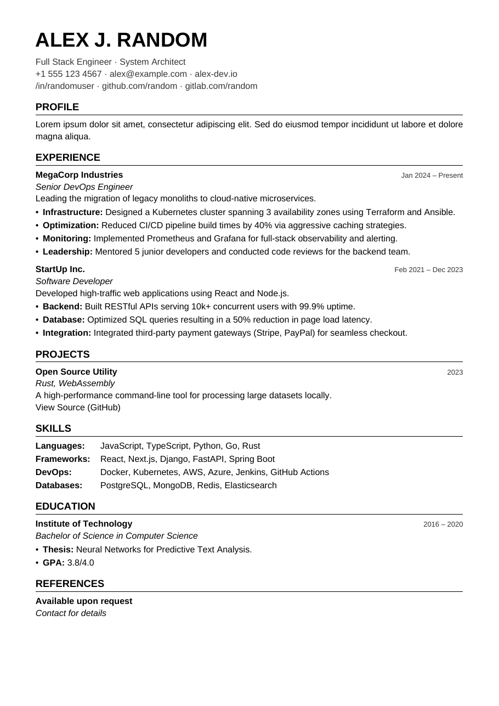

# cv-maker

Write your CV in Markdown, get a Swiss-minimal PDF.

Edit `cv.md`, run `cvmaker`, get `cv.pdf`: a clean, ATS-friendly,
print-ready PDF. The look follows [swiss-minimal-cv](https://github.com/obk/swiss-minimal-cv),
but you don't need LaTeX: one small binary, no TeX distribution, no browser.



## Features

* **Markdown in, PDF out.** Your CV is a readable text file that you can diff, review and version in git.
* **Swiss-minimal design.** Helvetica-style type, one column, strong hierarchy, generous whitespace.
* **ATS friendly.** The PDF holds real, selectable text in reading order, with clickable links and proper metadata.
* **Batteries included.** A Helvetica/Arial-metric font is embedded in the binary, so a build works offline.
* **Any font.** You can use an embedded font, your installed fonts, a `fonts/` folder, or any family from [Google Fonts](https://fonts.google.com), which is downloaded and cached for you.
* **Optional photo.** Square, rounded or circular, on the right or left of the header.
* **Full Unicode Latin.** Turkish is supported, with correct `i → İ` uppercasing when `lang: tr` is set.
* **Live preview.** `cvmaker watch` rebuilds the PDF every time you save.

## Contents

- [Installation](#installation)
- [Quick start](#quick-start)
- [How it works](#how-it-works)
- [Writing your CV](#writing-your-cv)
- [Configuration](#configuration)
- [Fonts](#fonts)
- [Photo](#photo)
- [Command line](#command-line)
- [Tips](#tips)
- [Development](#development)
- [License](#license)

## Installation

You need [Go](https://go.dev/dl/) 1.22 or newer.

```sh
go install github.com/obk/cv-maker/cmd/cvmaker@latest
```

This puts `cvmaker` into `$(go env GOBIN)`, which defaults to `~/go/bin`. Make sure that folder is on your `PATH`, or choose another folder:

```sh
GOBIN=~/.local/bin go install github.com/obk/cv-maker/cmd/cvmaker@latest
```

From a clone, `make install` does the same, and `make build` writes `bin/cvmaker`.

Without Go, download a prebuilt binary for Linux, macOS or Windows from the [releases page](https://github.com/obk/cv-maker/releases) and put `cvmaker` somewhere on your `PATH`.

## Quick start

Keep your CV in its own folder (or private repository), separate from the tool:

```sh
cvmaker init my-cv      # writes my-cv/cv.md and my-cv/config.yml
cd my-cv
cvmaker                 # cv.md + config.yml  ->  cv.pdf
```

1. Replace the sample content in `cv.md` with your own.
2. Adjust fonts, colors, margins or the photo in `config.yml`.
3. Run `cvmaker` again.

To keep the PDF up to date while you edit, run:

```sh
cvmaker watch
```

Most PDF viewers reload the file automatically when it changes (Evince, Okular, Skim, the VS Code PDF preview, and others).

## How it works

```
cv.md ──► front matter split ──► Markdown parser ──► CV model ──► layout ──► cv.pdf
            │                     (goldmark)          name,         (fpdf, fonts
config.yml ─┴──► settings ──────────────────────────► sections,    subset and
                                                      entries, ...  embedded)
```

1. **Settings** are layered. The built-in defaults come first, then `config.yml`, then the optional front matter at the top of `cv.md`. Each layer only needs the keys it changes.
2. **Markdown** is parsed with [goldmark](https://github.com/yuin/goldmark) (CommonMark, plus definition lists, autolinks and smart punctuation) and mapped onto a small CV model. See the [mapping](#element-reference) below.
3. **Layout.** A small typesetter breaks lines, justifies paragraphs, keeps headings with their content across page breaks and draws everything with [fpdf](https://github.com/go-pdf/fpdf). Only the glyphs you use are embedded, so a typical CV is about 50 KB.

## Writing your CV

A complete CV looks like this ([examples/cv.md](examples/cv.md) is the one in the preview):

```markdown
# Alex J. Random

Full Stack Engineer · System Architect
+1 555 123 4567 · <alex@example.com> · [alex-dev.io](https://alex-dev.io)

## Profile

Engineer with ten years of experience in distributed systems.

## Experience

### MegaCorp Industries | Jan 2024 -- Present

*Senior DevOps Engineer*
Leading the migration of legacy monoliths to cloud-native microservices.

- **Infrastructure:** Designed a Kubernetes cluster spanning 3 availability zones.
- **Optimization:** Reduced CI/CD pipeline build times by 40%.

## Skills

Languages:
: JavaScript, TypeScript, Python, Go, Rust

Databases:
: PostgreSQL, MongoDB, Redis
```

### Element reference

| You write | You get |
|---|---|
| `# Name` | The name at the top, large, bold and uppercase. Also used as the PDF title and author. |
| Lines right under `# Name` | Header lines in the muted color, such as your title, phone, email and links. Each source line stays on its own line. |
| `## Section` | A section title with a rule underneath. Every `##` starts a new section. |
| `### Title \| Date` | An entry: the title in bold on the left, and the text after the last `\|` in small type, flush right. The date part is optional. |
| `*text*` / `**text**` | *Italic* / **bold**. Put a role or degree on its own line in italics. |
| `- item` / `1. item` | Bullet or numbered lists. Indent an item to nest it. |
| `Term` + `: description` | A two-column table, useful for skills and languages. The first column is as wide as the longest term. |
| `[text](https://…)` | A clickable link. Bare URLs and `<you@mail.com>` are linked too. |
| `#### Heading` | A small bold heading inside a section. |
| `***` | A thin divider line. |
| `<!-- pagebreak -->` | Starts a new page. |
| `--` / `---` / `"…"` | En dash, em dash and typographic quotes. |

Some details:

* **Line breaks.** By default every new line in the source is a new line in the PDF, and a blank line starts a new paragraph. This makes stacked lines (role, then description) easy to write. To get standard Markdown behavior, where lines are joined, set `hard_wraps: false`. The header always keeps its lines.
* **Pipe in a title.** Only the last `|` outside a link splits an entry. `### [A | B](https://x) | 2024` keeps the link intact.
* **Definition lists** need the term on its own line and the description on the next line, starting with `: `. A term may have several descriptions; each one goes on its own line.
* **Images** in the Markdown are ignored. Use the [photo](#photo) setting instead.

## Configuration

A build reads `config.yml` (or `config.yaml`) from the same folder as `cv.md`. To use another file, pass `-c path/to/config.yml`. You can also put settings in front matter at the top of `cv.md`. Front matter wins over the config file:

```markdown
---
page: Letter
font:
  size: 10
---
# Alex J. Random
```

Unknown keys are reported as errors, so typos don't go unnoticed. Relative paths (fonts, photo) are resolved against the folder of the file that sets them.

### All settings

The values shown are the defaults. [examples/config.yml](examples/config.yml), which `cvmaker init` copies, has the same list with comments.

```yaml
# PDF metadata
title: ""              # default: the name from "# Name"
author: ""             # default: the name from "# Name"
subject: ""
keywords: []
lang: ""               # e.g. en, de, tr. "tr"/"az" also switch to Turkish uppercasing

page: A4               # A4, Letter or Legal
margins:               # millimetres
  top: 12.5
  bottom: 12.5
  left: 15
  right: 15

font:
  family: Liberation Sans
  source: auto         # auto, local or google, see "Fonts"
  weight: 400          # Google Fonts only
  bold_weight: 700     # Google Fonts only
  files:               # explicit .ttf files, these win over family
    regular: ""
    bold: ""
    italic: ""
    bold_italic: ""
  size: 10.5           # body text, in points
  line_height: 1.35    # multiple of size
  name_size: 24
  section_size: 12
  meta_size: 8.5       # dates next to entries

colors:                # "#rrggbb" or "#rgb"
  text: "#000000"
  muted: "#333333"     # header lines and dates
  rule: "#000000"      # line under section titles
  link: "#000000"      # links in body text (header links stay muted)

photo:
  path: ""             # JPEG or PNG; empty = no photo
  size: 28             # millimetres
  shape: square        # square, rounded or circle
  position: right      # right or left

spacing:               # points of space placed before each kind of block
  header: 4            # between the name and the header lines
  section: 11
  entry: 7
  block: 2             # paragraphs and lists
  item: 1.5            # between list items

hard_wraps: true       # every source line is a line in the PDF
justify: true          # justified body text
uppercase: true        # NAME and SECTION TITLES in capitals
underline_links: false
rule_width: 0.5        # points
```

## Fonts

There are four ways to choose a font, from simplest to most explicit.

**1. Embedded (default).** *Liberation Sans* is built into the binary. It has the same metrics as Helvetica/Arial, covers all Latin languages including Turkish, and works offline.

**2. Google Fonts.** Set any family from [fonts.google.com](https://fonts.google.com):

```yaml
font:
  family: Inter
  weight: 300          # a lighter, very Swiss look
  bold_weight: 600
```

The first build downloads static TrueType files for the four styles into your user cache folder (`~/.cache/cvmaker/fonts` on Linux, `~/Library/Caches/cvmaker/fonts` on macOS, `%LocalAppData%\cvmaker\fonts` on Windows). Later builds read them from there. If a family has no italic or bold, the nearest available style is used. Families that work well for a Swiss look include *Inter*, *Work Sans*, *IBM Plex Sans*, *Manrope*, *Public Sans* and *Archivo*.

**3. Installed or project fonts.** With `source: auto` (the default) or `source: local`, cvmaker first looks for the family in a `fonts/` folder next to `cv.md`, then in the fonts installed on your system. Files are matched by the usual naming scheme, for example `Inter-Regular.ttf`, `Inter-Bold.ttf`, `Inter-Italic.ttf` and `Inter-BoldItalic.ttf`. `local` never touches the network. `google` always downloads, even when the family is installed.

**4. Explicit files.** If a family uses unusual file names, list the files:

```yaml
font:
  files:
    regular: fonts/MyFont-Book.ttf
    bold: fonts/MyFont-Heavy.ttf
    italic: fonts/MyFont-BookItalic.ttf
    bold_italic: fonts/MyFont-HeavyItalic.ttf
```

> Only TrueType outlines (`.ttf`) can be embedded. OpenType CFF (`.otf`), Type 1 and variable fonts are not supported. For variable fonts, Google Fonts serves static instances automatically.

## Photo

Many markets, Germany and Turkey among them, expect a photo, while others (the US and UK) usually don't. Leave the photo out unless it is expected where you apply.

```yaml
photo:
  path: photo.jpg      # relative to config.yml (or cv.md for front matter)
  size: 30             # millimetres
  shape: circle        # square, rounded or circle
  position: right      # right or left
```

The image is scaled to cover the square and cropped to the center, so a portrait photo works without editing. JPEGs are embedded as they are. PNGs of any bit depth are converted to 8-bit first.

## Command line

```
cvmaker [flags] [cv.md]         same as build
cvmaker build [flags] [cv.md]   write the PDF next to the input
cvmaker watch [flags] [cv.md]   rebuild whenever the CV, config or assets change
cvmaker init  [dir]             create cv.md and config.yml to start from
cvmaker version

Without a file, cv.md in the current folder is used.

Flags for build and watch:
  -o <file>     output PDF path
  -c <file>     config file (default: config.yml or config.yaml next to cv.md)
```

Examples:

```sh
cvmaker                                       # cv.md -> cv.pdf
cvmaker -o dist/alex-random.pdf
cvmaker cv.tr.md -c config.tr.yml             # e.g. a Turkish version
cvmaker watch
```

The PDF is written to a temporary file and then renamed into place, so a viewer never shows a half-written file.

## Tips

* **Several languages or versions.** Keep `cv.en.md` and `cv.tr.md` side by side and share one `config.yml`. Put the differences, such as `lang: tr`, in each file's front matter.
* **Turkish.** Set `lang: tr` so uppercasing follows Turkish rules (`istanbul → İSTANBUL`, `ılık → ILIK`).
* **One page.** To fit more on a page, lower `font.size` to 10, `font.line_height` to 1.25 or `spacing.entry` to 5 before you cut content.
* **Page breaks.** Section titles and entry titles never end up alone at the bottom of a page. Use `<!-- pagebreak -->` when you want to choose where a page breaks.
* **ATS check.** `pdftotext cv.pdf -` shows what a parser sees. It should match your Markdown, in order.
* **In CI.** `go run github.com/obk/cv-maker/cmd/cvmaker@latest` in a GitHub Action gives you a fresh PDF on every push, with nothing to install.

## Development

```sh
make build      # bin/cvmaker
make install    # into $GOBIN
make test       # go vet + go test
make preview    # regenerate docs/preview.png (needs pdftoppm)
make dist       # release archives for Linux, macOS and Windows in dist/
```

Project layout:

```
cmd/cvmaker              CLI: build, watch, init
examples/                sample cv.md and annotated config.yml (embedded for `init`)
internal/config          settings, YAML layering, validation
internal/cv              Markdown → CV model (goldmark)
internal/fonts           embedded font, local lookup, Google Fonts download + cache
internal/render          line breaking, justification, page layout (fpdf)
```

## License

MIT, see [LICENSE](LICENSE). The embedded Liberation Sans fonts are licensed under the SIL Open Font License 1.1 ([internal/fonts/liberation/LICENSE](internal/fonts/liberation/LICENSE)).
